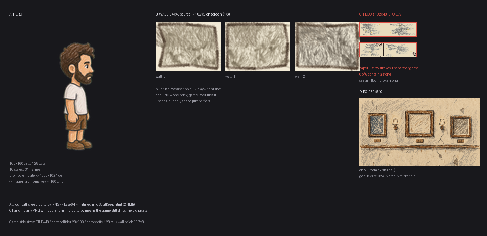

# 美术资产盘点（2026-11-26 · 实盘）

> 这份写**现状和问题**，不写规格。
> 规格在 `ART_PIPELINE.md`（配方 / 分层 / 锚点），需求清单在 `ASSET_MANIFEST.md`（还差哪些）。
>
> 一句话结论：**四条产线都在跑，但只有"角色"这一条是完整的。**
> 墙砖刚立住，地砖是废件，背景只有一间房，UI 和敌人还全是代码画的。



---

## 1. 数量实盘

| 类 | 现状 | 规格 | 产线 | 状态 |
|---|---|---|---|---|
| 角色 sprite | **10 状态 / 31 帧** | 160×160 网格，角色高 128 | 生图 → 洋红抠图 → 定网格 | ✅ 跑通 |
| 墙砖 | 6 张 | 64×48，一张一块砖 | p5.brush 程序渲染 | ✅ 可用 |
| 地砖 | 6 张 | 192×48 | 生图裁切（失败） | 🔴 **废件** |
| 平台板 | 6 张 | 48×20 | 同上 | ✅ 可用 |
| 背景 | **1 张（只有 hall）** | 960×540 | 生图 → 裁切 | 🟠 只够一间房 |
| 敌人 | 0 张 | — | `game.js` fillRect | 🔴 程序画 |
| 道具（门/灯/画框） | 0 张 | — | `game.js` fillRect | 🔴 程序画 |
| UI | **0 张** | 见 `UI_SKIN.md` | CSS 色块 | 🔴 未开始 |
| 字体 | 0 | — | 系统等宽 | 🔴 未定 |

全部 PNG 经 `build.py` 转 base64 内嵌进 `SoulKeep.html`（2.4 MB）。
**换图不重跑 `build.py`，游戏里还是旧像素** —— 这坑踩过两次，写进 `STYLE_LOCK §L11` 了。

---

## 2. 四条产线

### 2.1 角色（唯一完整的链路）

```
art/prompts/sprite_prompt.py  ── 骨架模板 + 10 状态配置（只允许改背景句）
        │  sprite_template.txt（LAYOUT / POSES / PROPORTIONS / Medium / NOT）
        │  固定参数：1536×1024、quality high、image1=art/out/hero_side_idle.png、input_fidelity=high
        ▼
   生图（每状态一张横排 strip，N 帧 + N-1 条纯绿分割线 + 纯洋红底）
        ▼
art/tools/build_sheet_magenta.py
        │  ① patch_watermark（右下角 AI 水印涂回底色，不裁底 —— 会切到靴子）
        │  ② full_height_seps（模型只把分割线画到人那么高，先补满整列）
        │  ③ cut_frames（复用 E:/IdentityCard/tools/process_spritesheet.py）
        │  ④ 自适应洋红阈值：取四角底色色度 × 0.45（模型会把洋红冲淡成 #AD446F）
        │  ⑤ 连通域过滤：面积 < 最大块 6% 的砍掉（游离拳头 2–4%，被笔触切断的腿 30–40%）
        │  ⑥ 预乘 alpha 再缩放（不预乘会让透明区的洋红渗成一圈紫边）
        │  ⑦ 全帧共用一个缩放系数 + 固定锚点（脚底 y=152 / 骨盆 y=94）
        ▼
art/hero/hero_<state>.png（160×N 行表）+ .gif + _proof.png（3× 放大验收图）
        ▼
build.py → window.ATLAS_B64 → game.js drawAtlasFrame()
```

**10 个状态 / 31 帧**：stand 4、walk 2、jump 3、fall 3、attack 4、cast 4、hurt 3、crouch 2、slide 3、dash 3。

代价：`art/hero/raw/` 里躺着 **22 张生图原图才换来 10 张成表**（2.2 次/状态）。
walk 试了 **5 次**，hurt 3 次，jump / attack / dash 各 2 次。

### 2.2 瓦片（p5.brush 程序渲染，不是生图）

```
art/tools/p5brush/tilegen8.html      白纸底 + 一块砖（stonePoly 抖动 + mass scribble 笔触 + 缝线）
    │  画布 = 64×48 × 6 倍超采样，出图再降采样
    │  一次只画一块：没有循环、没有排布、没有半砖（v3e~v7 全错在这）
    ▼
node art/tools/p5brush/render.js shot "tilegen8.html?seed=N&ss=6"  → art/tiles/wall_N.png
    │  起 python http.server（ES module 不能走 file://）+ playwright 截图
    ▼
build.py → TILE_B64.wall → paintWallTiles()
    │  两行错缝做成一个 pattern 重复单元，一次 fillRect 铺满墙格
    │  源图 64×48 → 游戏内 1/6 ≈ 10.7×8（WALL_BW/BH = 64/6、48/6）
```

**为什么瓦片不走生图**：模型排不好砖。一张图里让它排 4 行 3 块，出来的缝宽不齐、砖大小不一，
平铺后是"歪的"。p5.brush 是确定性代码，同一 seed 出同一块砖，6 个 seed 出 6 种外形。

### 2.3 背景（生图整幅）

```
生图 1536×1024（蜡笔纸纹 + 墙面 + 3 个画框 + 2 盏壁灯 + 木压条）
    ▼  裁切 + 缩放到 960×540
art/bg/bg_hall.png
    ▼
build.py → BG_B64 → 游戏内镜像拼接平铺，视差 0.28
```

只有 `hall` 一间房有背景板。第二个房间要重出一张 —— 这是**每间房一次生图成本**，
不是"一套背景通用"。

### 2.4 程序画（严格说不是"资产"）

`game.js` 里仍然是 `fillRect` / `createLinearGradient` 的世界：

| 对象 | 位置 |
|---|---|
| 史莱姆 / 蝙蝠 | `drawSlime()` `drawBat()` |
| 门 / 灯 / 墙面展品框 | `drawDoor()` `drawLamp()` `drawWallMan()` |
| 刀光 / 粒子 / 暗角 | 各 draw 函数内联 |
| 血条 / 装备槽 / 魂名 / 键位提示 | CSS + canvas |

`art/tools/crayon.py` 是"程序画的唯一入口"（12 色板 + 受约束笔宽），但**已经没有任何调用者** ——
INDEX 里标着 🟢 现行，实际只有文档引用它。真正的程序画出图统一走 p5.brush 了。

---

## 3. 样图

| 图 | 看什么 |
|---|---|
| `art/hero/_ALL_STATES.png` | 10 状态总表，验比例/脚线/身份一致性 |
| `art/hero/hero_<state>.gif` | 单状态播放效果 |
| `art/hero/hero_<state>_proof.png` | 3× 放大 + 地面红线，验锚点 |
| `shots/art_overview.png` | 四类资产并排 + 尺寸标注 |
| `shots/art_floor_broken.png` | 地砖废件取证（源图 vs 6 张结果） |
| `shots/tile_check.png` | 瓦片 1 倍平铺 + 3 倍放大（`tile_preview.py` 出的，但见 §4.3） |

---

## 4. 问题

### P0-1 地砖：素材是废件，绘制入口也没了

两个独立的错叠在一起：

1. **6 张 `floor_*.png` 内容全是错的。** 从生图那张 1024×1024（`art/tiles/ref_gen/`）裁切时，
   框落在了**石头周围的纸底**上 —— 每张 192×48 里只有零星笔触 + 一条绿分割线的残影，
   没有一块完整的石头。6 张无一例外（见 `shots/art_floor_broken.png`）。
2. **`paintFloorTiles()` 被删了。** `git log -S paintFloorTiles`：
   `883945b` 加的，`0060455`（改墙砖那次）被改名成了墙砖路径。

后果：地面格现在由 `paintWallTiles()` 统一铺 1/6 墙砖 —— 砖约 10.7×8，密度是墙的 6 倍，
读起来像"砂砾地"而不是石板地。同时违反 `STYLE_LOCK §L11` 第 5 条
「墙与地是两条独立路径，不许互相改写」。

> ⚠ 只恢复函数没用：那 6 张图就算接上去也是画噪点。**图和函数都得重做。**

### P0-2 同屏两种砖尺度（背景 40px vs 瓦片 10.7px）

`bg_hall.png` 是 1536×1024 缩到 960×540 的整幅画，**它自带砖纹，砖约 40px**。
瓦片墙是 10.7px。同一屏里两种砖并存，看起来像"背景是巨人的房子"。
`shots/_v_desktop.png` 里能直接看到：中间大片是背景的大砖，左右两侧和地面是小砖。

这不是 bug，是**两套资产没有对齐尺度**。

### P1-1 检查工具本身过期，会给出假报警

`art/tools/tile_preview.py` 里 `N = 192`，并断言输入是 192×192。
现在瓦片是 64×48，跑起来第一句就是 `! wall_0 尺寸 (64, 48)，期望 (192, 192)`，
然后按 192 去 resize/paste —— 出的对照图是错的。

同类的：`render.js` 的 `tileset` 模式指向 `tilegen.html`，实际文件已改名 `tilegen8.html`，
这个模式现在会 404。当前 6 张墙砖是手工用 `render.js shot <page>` 一键一图出的。

### P1-2 墙砖本身三个小毛病

放大 3 倍看（`art/tiles/wall_0..5.png`）：

| 毛病 | 具体 |
|---|---|
| 6 个 seed 差异不足 | 轮廓抖动不同，但涂法和色相几乎一样，平铺后像"同一块砖复印" |
| `wall_3` 色相跑偏 | 灰紫，其余 5 张是米褐 —— 平铺会形成色斑 |
| 四角露纸白 | 底涂 `strength 0.72` 没盖满画布，四角是纸色；平铺时相邻两块相加，缝偏宽偏亮 |

### P1-3 背景只有一间房

`bg` 目录只有 `bg_hall.png`。`ROOMS` 里的第二个房间目前没有背景板 ——
真跑起来要么复用 hall（同一面墙走两遍），要么退回代码渐变。

### P2 完整性缺口

| 缺什么 | 现状 |
|---|---|
| 敌人 sprite | 史莱姆 / 蝙蝠全是 `fillRect`，站在手绘场景里像两个色块 |
| 门 / 灯 / 画框 | 同上，代码画 |
| UI 全套 | 0 资产。血条是 CSS 渐变，装备槽是 1px 边框，5 个魂**没有图标只有两字短名**，字体是系统等宽 |
| walk 只有 2 帧 | 跑起来是"两帧抖"，比 4 帧明显廉价 |
| jump 顶点帧偏小 | 全帧共用缩放系数的代价：抬腿帧矮、顶点帧被按最高帧缩过一次 |

### P2 成本与卫生

- **生图重试率 2.2 次/状态**（22 张 → 10 表）。walk 5 次。这是"每加一个动作 ≈ 2~3 张图"的真实单价，
  排期要按这个算，不能按"1 个状态 1 张"算。
- **废地砖每天被打包进 html**：`build.py` 按 `<kind>_<i>.png` 自动收，6 张废图 ≈ 120KB base64 白背。
- `shots/` 里 **197 张 PNG / 92MB**，其中约 23 张是调参对比图（`pw_wall_*` `flat_zoom_*` `coat_*`），
  已被结论取代。
- `art/out/` 里 33 张，其中 12 张 `proof_*` 是 R2「薄卡片 2.5D」时期的验证图，
  画法早改成 P6 蜡笔，这批只剩溯源价值。

---

## 5. 下一步（按"画面提升 / 成本"排）

| # | 做什么 | 为什么排这 |
|---|---|---|
| 1 | **重做地砖**：p5.brush 出单块石板（建议 48×24 或 64×32，一张一块），`paintFloorTiles` 按错缝平铺；顺手删 6 张废件 | 地面是玩家 90% 时间盯着的东西，现在是错的 |
| 2 | 对齐背景与瓦片的砖尺度（二选一：背景重出时把砖压到 ~10px；或瓦片放大到 1/4） | 不同屏存在两套砖，怎么调都别扭 |
| 3 | 修两个工具断点（`tile_preview.py` 的 N、`render.js` 的 tilegen 路径） | 检查工具本身错了，比没有工具更危险 |
| 4 | 补第二间房的背景板 | 有第二个房间才有"探索" |
| 5 | 墙砖再出 6 个 seed，压掉 `wall_3` 的色相，底涂盖满 | 低成本，直接把重复感降一档 |
| 6 | 敌人 2~3 种 sprite（进同一条洋红管线） | 手绘场景里唯一的色块就是敌人 |
| 7 | UI 皮（血条 9 帧 / 九宫格框 / 5 个魂图标 / 字体） | 见 `UI_SKIN.md`，不定 UI 永远比画面低一档 |

**不建议现在做的**：把 31 帧重出一遍、给 walk 补到 4 帧。手感还没钉完，
帧数加了也是白加 —— 先让地面和背景对，再谈角色细节。
